<p align="center"></p>

<h1 align="center">Ariane Plus</h1>

<p align="center"><b>Map Editor by Dryxio, edited by NikolasOG</b><br>
A free, open-source fork of <a href="https://github.com/Dryxio/ariane">Ariane</a> for GTA III, Vice City and San Andreas,<br>
extended for SA-MP and open.mp mapping.</p>

<p align="center">
<a href="https://github.com/NikolasOG/ariane-plus/releases/latest"><b>Download</b></a> ·
<a href="#whats-new-in-ariane-plus">What's new</a> ·
<a href="#proof-of-concept-carson-haven">Proof of concept</a> ·
<a href="#server-side-arianeinc">Server SDK</a> ·
<a href="#mapping-with-an-ai-agent">AI mapping</a> ·
<a href="CREDITS.md">Credits</a>
</p>

> **Ariane Plus is an unofficial fork.** It is not affiliated with or endorsed by Dryxio. Ariane is
> Dryxio's work, built on aap's euryopa and librw — all credit for it stays with its creators (see
> [CREDITS.md](CREDITS.md)). For the original editor, go to [Dryxio/ariane](https://github.com/Dryxio/ariane).

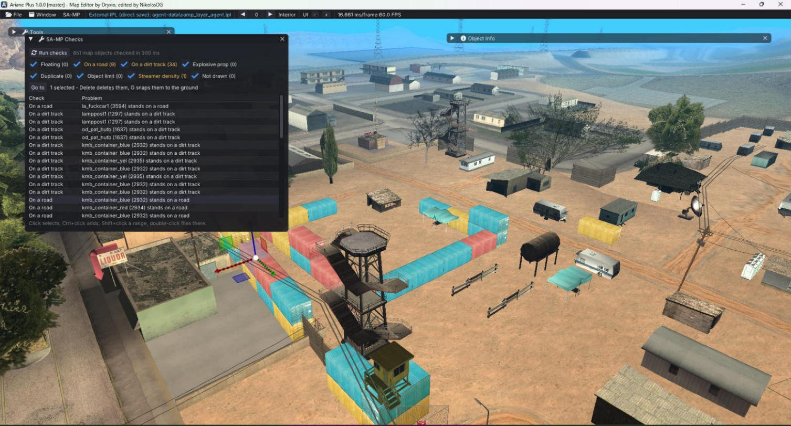

## What's new in Ariane Plus

Everything Ariane does, plus a full workflow for SA-MP / open.mp servers: map in the editor, see it live
on your server, and keep the game files untouched.

### SA-MP / open.mp mapping

- **SA-MP mode** keeps your game files safe: new objects go to a separate SA-MP layer, and deleting or moving
  a game building becomes `RemoveBuildingForPlayer` instead of an IPL edit.
- **Import** SA-MP, Texture Studio and MTA maps (or drag a file onto the window). **Export** Pawn for the
  streamer plugin, native open.mp / SA-MP `CreateObject`, or your own wrapper functions.
- **Live sync**: *Sync to server* (Ctrl+Shift+S) writes `scriptfiles/ariane_live.txt` and the server
  rebuilds the map within seconds; *Reload from server* brings the server's map back into the editor.
- SA-MP's own models, **custom models** (`AddSimpleModel` from `models/artconfig.txt`) and **material
  overrides** are all rendered in the editor.
- **Show in game** (Ctrl+Shift+T): sync, then move players to the editor's view — RCON admins, players your
  own script picks, one named player, or everyone. Your server can also point the editor's camera at a
  player or a spot.

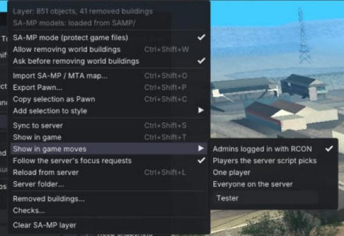

### SA-MP Checks

*SA-MP > Checks* finds the mistakes that are easy to miss: floating objects, objects on roads or dirt
tracks, explosive props, duplicates, too many objects for `CreateObject`, and spots where the streamer
can't show everything at once. Click a problem to select its object, double-click to fly there
(screenshot at the top).

### Removing world buildings

Remove game buildings by hand, even while another map is open: turn on *SA-MP > Allow removing world
buildings* (Ctrl+Shift+W), select a building and press Delete. Ariane Plus asks first, removes its
far-away LOD with it, and exports it as `RemoveBuildingForPlayer` — no IPL file changes, and Ctrl+Z
brings it back. *SA-MP > Removed buildings* lists every removal, nearest first, to fly to or restore.

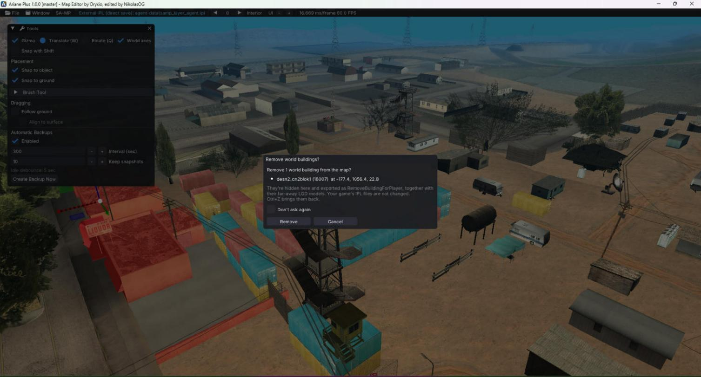

<p align="center">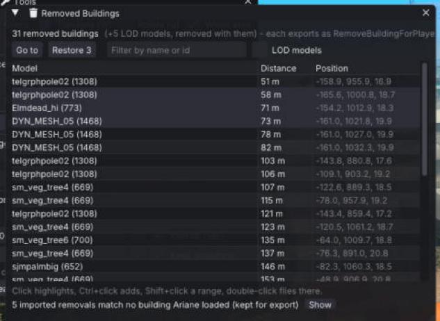</p>

### Groups

Select objects and press **Ctrl+Shift+G** to group them under a name. Clicking any member selects the
whole group, the gizmo moves it as one, and rotation turns it around its centre. *Window > Groups* lists
them: go to, rename, duplicate, save as a prefab, ungroup or delete. Placing a prefab groups it
automatically, and groups survive restarts.

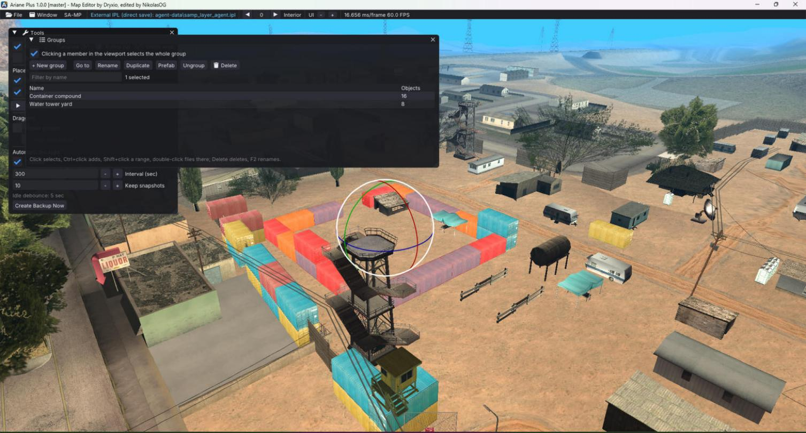

### Materials in Object Info

Retexture or recolour any placed object slot by slot: pick a texture from thumbnails of any TXD, set
the material colour, copy a look to other objects. Same data as SA-MP's `SetObjectMaterial`; it syncs
and exports like any edit.

<p align="center">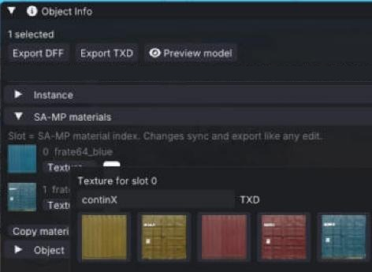</p>

### Model Viewer

An orbitable close-up of any model (Object Browser > *Preview*, or **P**): textured, clay or wireframe;
collision, bounds, axes and a 1.8 m person for scale; materials, every texture of its TXD and collision
stats; place it or fly to the nearest one.

<p align="center">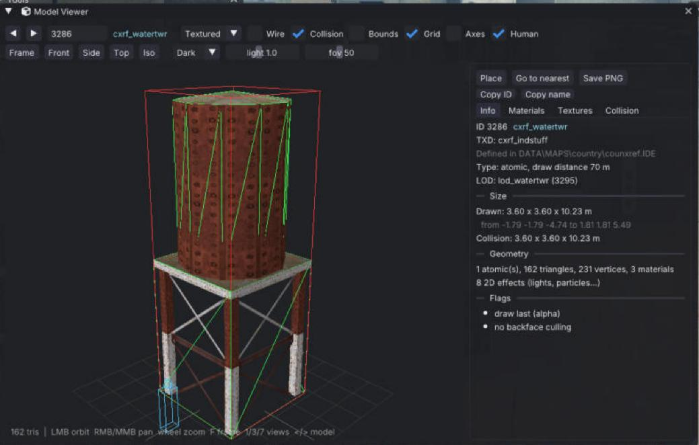</p>

### And more

- **Draw distance in the top bar**, next to the FPS counter: draw map objects up to 3 km away (300 m by
  default, the streamer's stream distance) and scale the world's draw distance, live.
- **Mapping styles**: curated model sets (for example *wasteland*) for consistent maps.
- **Building blocks**: exact-size plain shapes to compose and retexture custom objects.
- Fixes: dropped quick clicks and key taps, lost or squashed panels, mirrored thumbnails, and more.

The full list of changes is in [SAMP-EDITION.md](SAMP-EDITION.md).

## Proof of concept: Carson Haven

A wasteland settlement mapped in and around Fort Carson with Ariane Plus: about 850 objects, 36 removed
game buildings, ruined lots and retextured pieces. All screenshots are taken inside Ariane Plus.

<p align="center">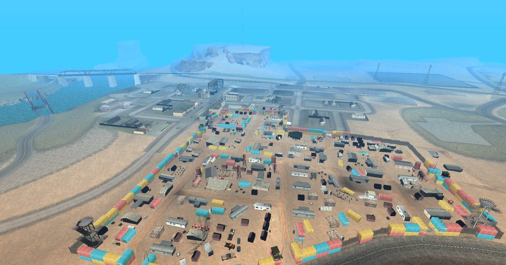</p>

> **Made with Ariane Plus's agentic capabilities, hooked into Claude.** Claude drove the editor through
> the Ariane Plus agent toolkit (the `arianectl` CLI and MCP server): it scanned the ground, laid out the
> settlement, placed, settled and retextured the objects and removed the game buildings in the way.
> The result was then checked and refined in the editor with the tools above.

**The settlement**

| | |
|---|---|
| 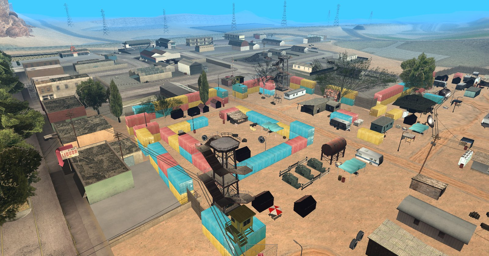 | 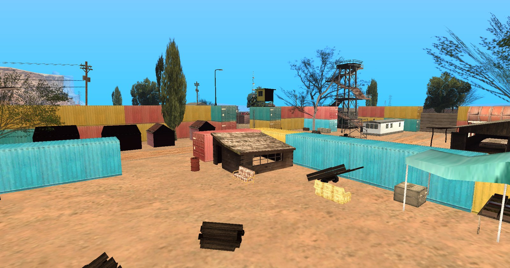 |
| 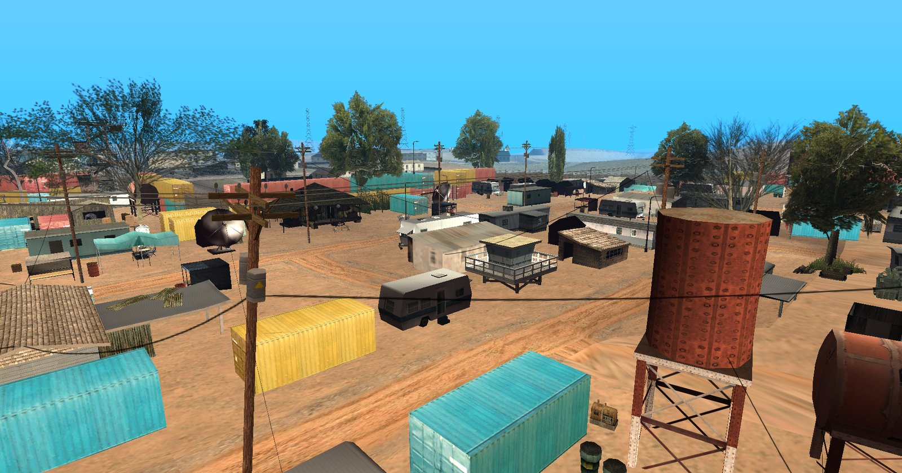 | 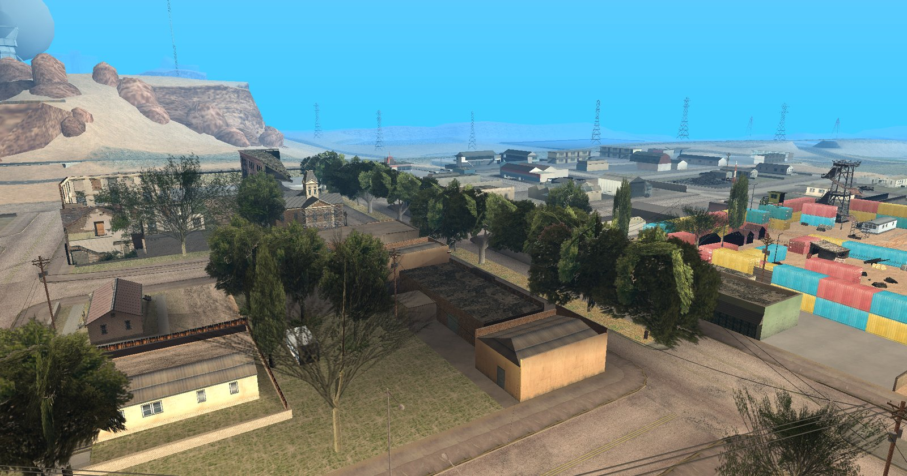 |

**Changes around Fort Carson**: houses removed and replaced with burnt-out lots, wrecks and rubble, and
the settlement running up to the edge of town.

| | |
|---|---|
| 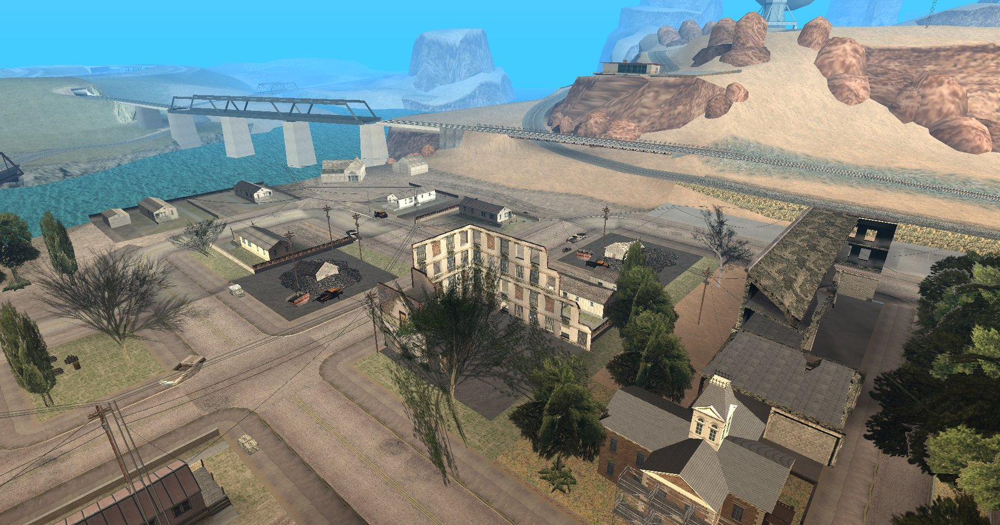 | 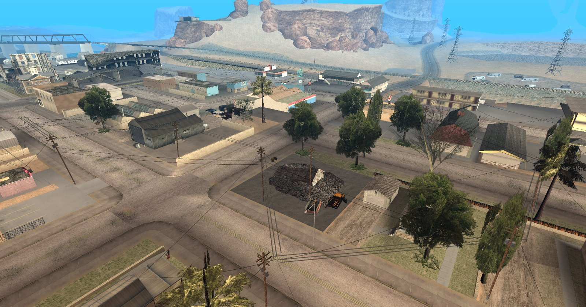 |

<p align="center">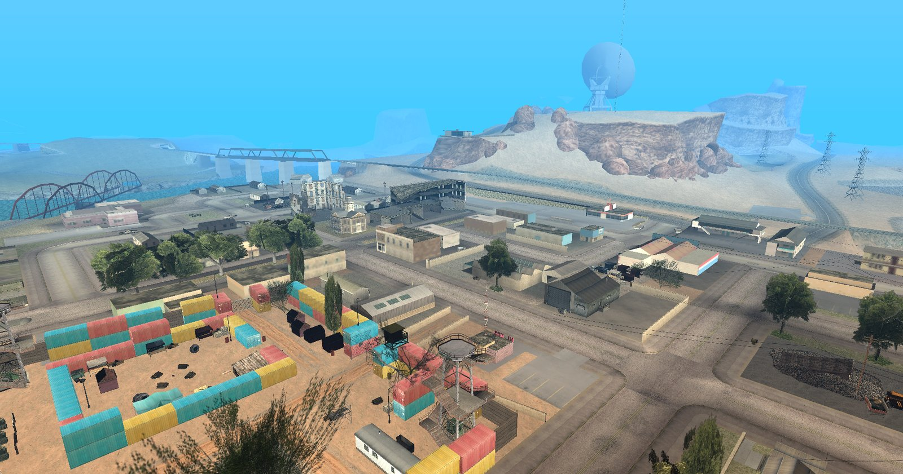</p>

## Server side: ariane.inc

[`tools/samp/ariane.inc`](tools/samp/ariane.inc) is the server side of Ariane Plus in one include for
open.mp and SA-MP (streamer plugin required), MIT-licensed so any gamemode can use it:

```pawn
#include <open.mp>
#include <streamer>
#include <ariane>          // starts by itself: live map, Show in game, removed buildings

// give live map objects behaviour
public OnArianeObjectCreate(STREAMER_TAG_OBJECT:objectid, modelid, index)
{
    return 1;
}

// your own permission check for "Players the server script picks"
public Ariane_CanFollow(playerid)
{
    return IsPlayerAdmin(playerid);
}
```

It also has a fly-around **freecam** (`Ariane_FreecamStart` / `Ariane_FreecamStop`), `Ariane_FocusEditor`
to move the editor's camera from the server, queries for the live map and removed buildings, and
`Ariane_CreateObject` & co. so maps exported with the wrapper prefix `Ariane_` compile as they are. The full
reference is at the top of the file. Prefer no code? Load the ready-made filterscript
[`ariane_live.pwn`](tools/samp/ariane_live.pwn) (`/arianefreecam`, `/arianefocus`, `/arianeview` for RCON admins).

## Mapping with an AI agent

Ariane Plus includes an agent toolkit: a local CLI (`arianectl`) and an MCP server that let an AI agent
inspect assets, move the camera, capture images, place and retexture objects, lay walls, build from
blocks, lint a site and sync it to your server. Start with [SKILLS.md](SKILLS.md); the full reference is
[tools/agent/MAPPING_TOOLKIT.md](tools/agent/MAPPING_TOOLKIT.md). Install with
`python -m pip install '.[mcp]'` from a clone, and see [tools/agent/README.md](tools/agent/README.md) for
connecting the editor.

## Download and usage

Download a build from [Releases](https://github.com/NikolasOG/ariane-plus/releases/latest), place it in
your GTA San Andreas (or III / Vice City) folder and run it. Ariane Plus checks this repository for updates.
For SA-MP mapping, see [SAMP-EDITION.md](SAMP-EDITION.md): point *SA-MP > Server folder…* at your server
and load the filterscript or `ariane.inc` there.

The `ariane.asi` plugin (Test in Game, Hot Reload) and the optional integration ZIP come from the original
Ariane — see the [Ariane Discord](https://discord.gg/eE9s9H4e24). Please report Ariane Plus problems as
[issues on this repository](https://github.com/NikolasOG/ariane-plus/issues), not to the original project.

## Features inherited from Ariane

[](https://www.youtube.com/watch?v=jJipK1woGAk)

**[Watch Dryxio's complete Ariane walkthrough on YouTube →](https://www.youtube.com/watch?v=jJipK1woGAk)**

### Map editing

- Place, move, rotate and delete map objects, with brush placement for repeated objects
- Select individual objects or whole areas, then translate and rotate them with 3D gizmos
- Enter exact absolute transforms or relative deltas, switch between world and local axes, and copy or paste complete transforms
- Use grid and angle snapping, align objects to the ground, and snap them to nearby surfaces
- Copy, cut and paste selections—including paste in place—with undo and redo support

### Object Browser and prefabs

- Browse objects in list or thumbnail views, with categories, IDE filters, search and favorites
- Preview models in 3D before placing them
- Build reusable prefabs from map selections, then browse, import and place them as a group
- Import custom DFF models and TXD textures

### Saving and iteration

- Save to original game files or keep edits isolated in a modloader/Ariane destination
- Write text or binary IPL data and update IMG archives
- Review changes made since the last save and recover work from automatic backups
- Test GTA III, Vice City and San Andreas maps in game, and hot-reload supported San Andreas changes with `ariane.asi`

### World tools

- Edit San Andreas water and path nodes
- Control time, weather, rendering distance and post-processing while you work
- Inspect collisions, zones, object information and other map data

## Building from source

Ariane Plus builds like Ariane. It requires [Premake 5](https://premake.github.io/) and the
[`ariane` integration branch of librw](https://github.com/Southland-FR/librw/tree/ariane).
For reproducible release builds, use the exact librw commit pinned as
`LIBRW_REF` in `.github/workflows/build-euryopa.yml`. Set `LIBRW` to that librw
worktree before generating the project.

### Linux

Install the compiler and OpenGL/GLFW development packages. On Ubuntu or Debian:

```bash
sudo apt-get install build-essential libgl1-mesa-dev libglfw3-dev
```

Build librw, then Ariane Plus:

```bash
export LIBRW=/path/to/librw-ariane

(cd "$LIBRW" && premake5 gmake2)
CXXFLAGS=-std=c++14 make -C "$LIBRW/build" -j2 \
  config=release_linux-amd64-gl3 librw

premake5 gmake2 --channel=master
make -C build -j2 config=release_linux-amd64-gl3 euryopa
```

Run `bin/linux-amd64-gl3/Release/ariane` with a supported GTA game directory as the current working directory.

### macOS

```bash
export LIBRW=/path/to/librw-ariane
(cd "$LIBRW" && premake5 gmake2 --gfxlib=glfw)

# Apple Silicon
make -C "$LIBRW/build" config=release_macos-arm64-gl3 librw
premake5 gmake2 --channel=master
make -C build config=release_macos-arm64-gl3 euryopa

# Intel
make -C "$LIBRW/build" config=release_macos-amd64-gl3 librw
premake5 gmake2 --channel=master
make -C build config=release_macos-amd64-gl3 euryopa
```

### Windows

Run these commands from a Visual Studio developer shell:

```bat
set LIBRW=C:\path\to\librw-ariane

pushd %LIBRW%
premake5 vs2019
msbuild build\librw.sln /p:Configuration=Release /p:Platform=win-amd64-d3d9 /t:librw /m
popd

premake5 vs2019 --channel=master
msbuild build\librwgta.sln /p:Configuration=Release /p:Platform=win-amd64-d3d9 /t:librwgta;euryopa /m
```

Use `--channel=PE` instead when building the PE/FLA channel. The SA-MP features are developed and tested
on the Windows Direct3D 9 build.

## License

Ariane Plus is free software under the **GNU General Public License, version 2 or later** — because the
project depends on LZO (GPL), as the upstream README states. See [LICENSE](LICENSE). The SA-MP server
scripts in [`tools/samp`](tools/samp) are MIT-licensed so gamemodes can include them freely, and bundled
third-party components keep their own licenses (texts in [licenses/](licenses)).

GTA III, Vice City and San Andreas are trademarks of Rockstar Games / Take-Two Interactive. Ariane Plus is
not affiliated with them and ships no game files — you need your own copy of the game.

## Credits

- **[Dryxio](https://github.com/Dryxio)** — [Ariane](https://github.com/Dryxio/ariane), the editor this fork is built on
- **[aap](https://github.com/aap)** — the original euryopa/librwgta project and librw
- **[Southland-FR](https://github.com/Southland-FR)** — the `ariane` branch of librw
- Ariane contributors: Martin Turski, Anonymous Maarten, spicybung, dkluin
- **[NikolasOG](https://github.com/NikolasOG)** — Ariane Plus

Full credits and third-party licenses: [CREDITS.md](CREDITS.md).
